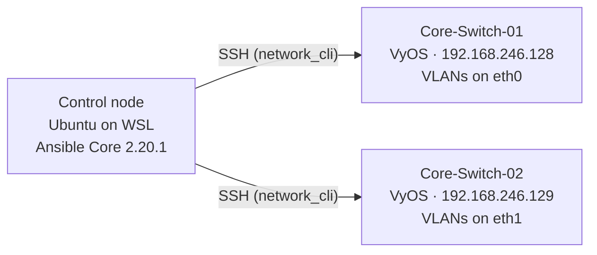
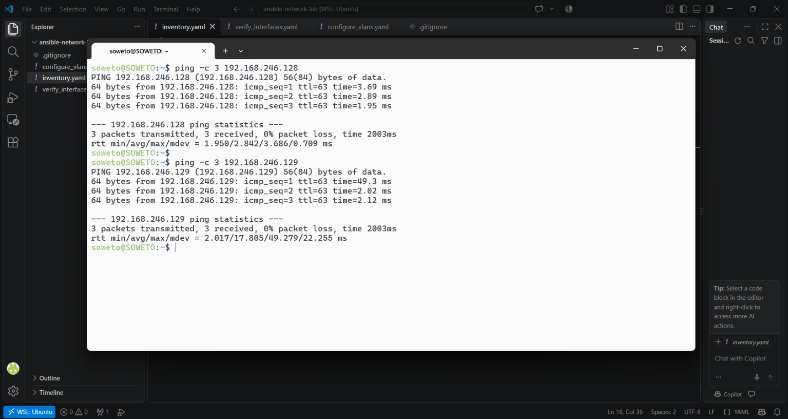
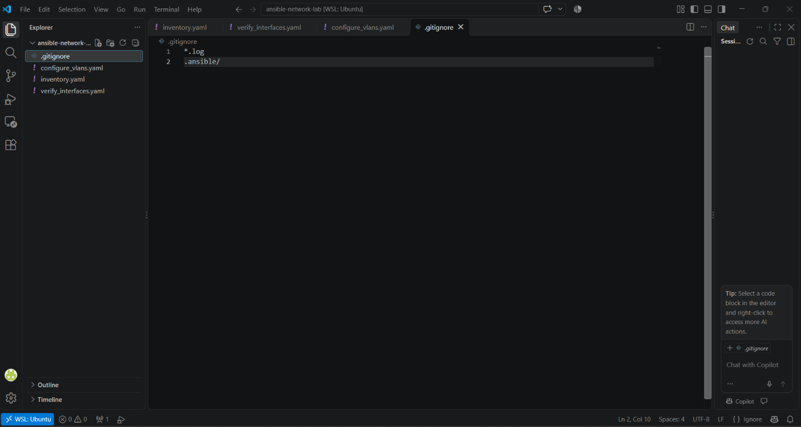
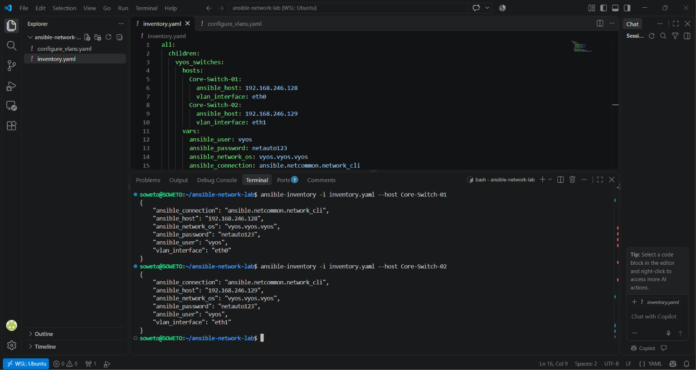
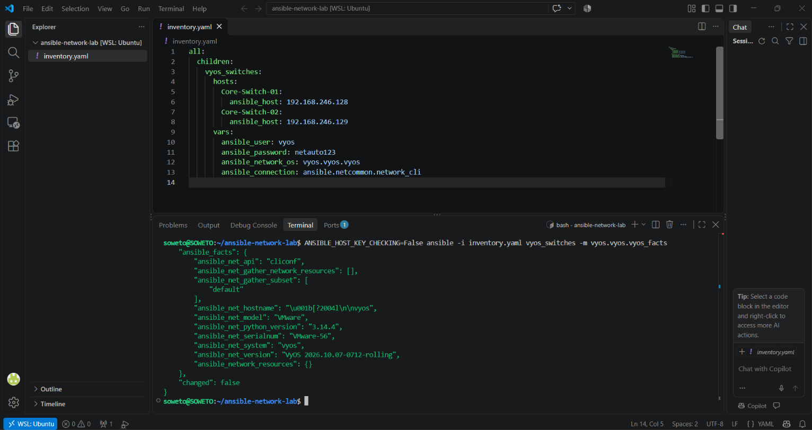
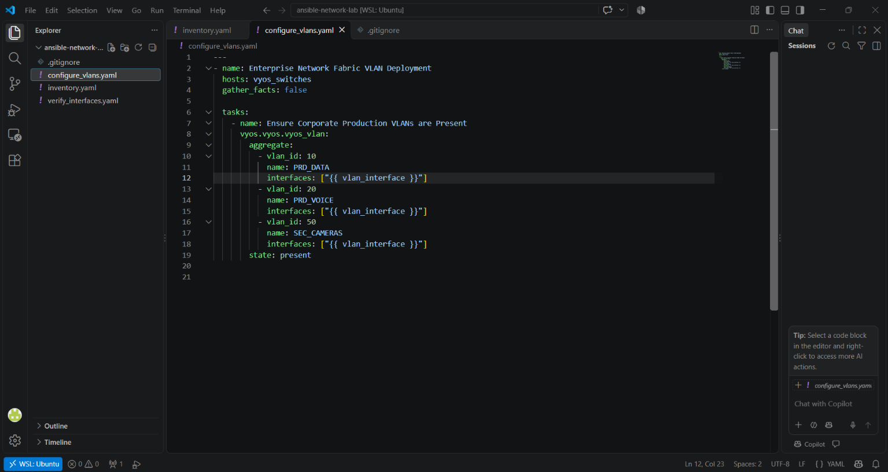
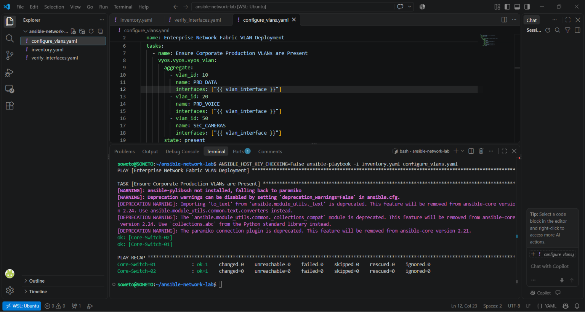
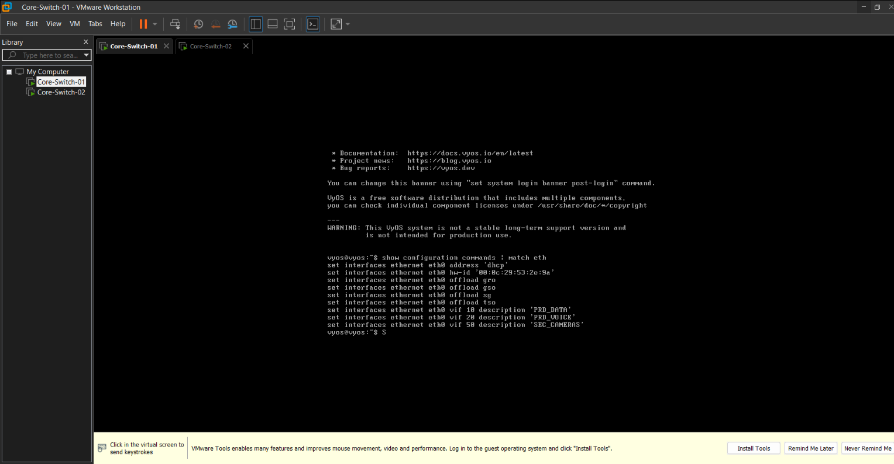
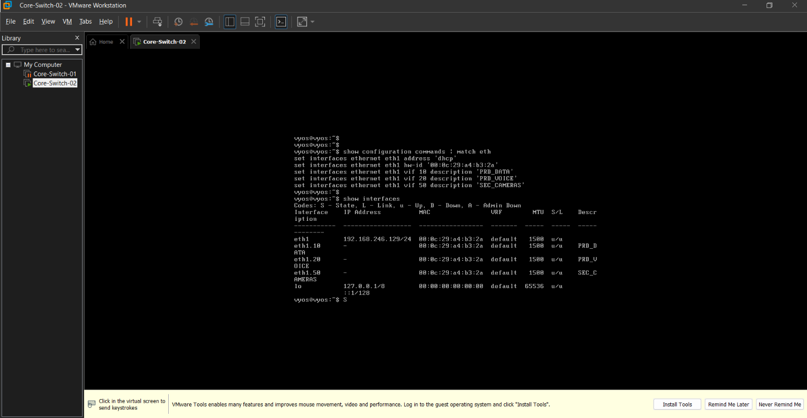
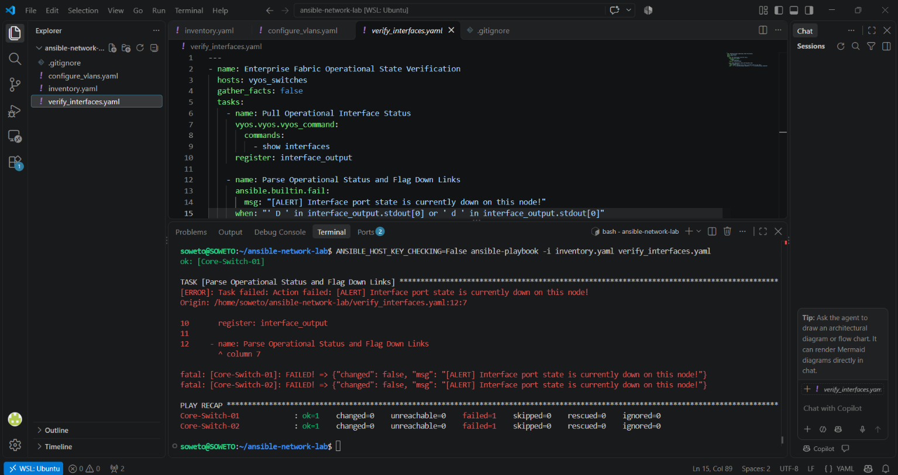

<div align="center">


<br/>


[Overview](#-overview) · [Architecture](#-architecture) · [Stack](#-technology-stack) · [Structure](#-repository-structure) · [Evidence](#-execution--verification-evidence) · [Finding](#-finding-a-false-positive-in-the-verification-gate) · [Results](#-test-results) · [Next steps](#-possible-next-steps)

</div>

---

## 📌 Overview

This project uses **Ansible Core** to deploy VLANs on two network devices at the same time. Instead of a simulator, it automates standalone **VyOS virtual appliances** running in VMware Workstation.

The playbooks are **declarative**: they describe the VLANs that should exist, and Ansible makes the devices match. A second playbook acts as a **verification gate**. It reads the interface state after deployment and is meant to stop the run when an interface is down.

**Highlights**

- One YAML inventory drives both VyOS nodes in parallel
- VLAN 10 `PRD_DATA`, VLAN 20 `PRD_VOICE` and VLAN 50 `SEC_CAMERAS` deployed by one playbook
- Running configuration and interface state checked on both devices
- A false positive in the verification gate was found, explained from the evidence, and corrected (see [Finding](#-finding-a-false-positive-in-the-verification-gate))

---

## 🏗️ Architecture



**Why automate this?** In a busy network, logging in to every device by hand leads to typing mistakes and configuration drift. An **idempotent** playbook can be run again and again and always ends in the same state, so every device gets the same configuration from one central inventory.

**How VLANs work on VyOS.** VyOS is a router operating system, so a VLAN is built as an 802.1Q sub-interface (`vif`) on an Ethernet interface. The host variable `vlan_interface` in the inventory chooses the parent interface for each device: `eth0` on Core-Switch-01 and `eth1` on Core-Switch-02.

**Management access.** Each node has one DHCP-addressed interface that Ansible uses for SSH, and the VLAN sub-interfaces are created on that same interface. A separate out-of-band management interface is the usual production design and is listed under next steps.

---

## 🛠️ Technology stack

| Layer | Technology |
|---|---|
| Automation control node | Ubuntu Linux on WSL |
| Orchestration engine | Ansible Core 2.20.1 with Python 3.14 |
| Connection | `ansible.netcommon.network_cli` with `ansible_network_os: vyos.vyos.vyos` |
| Modules | `vyos.vyos.vyos_facts`, `vyos.vyos.vyos_vlan`, `vyos.vyos.vyos_command` |
| Transport | SSH using Paramiko (the fallback when `ansible-pylibssh` is not installed) |
| Hypervisor | VMware Workstation |
| Target operating system | VyOS 2026.10.07 rolling release |

> **Note:** the usernames and passwords in this repository are throwaway values for an isolated lab. They appear in some screenshots.

---

## 📂 Repository structure

```text
.
├── README.md
├── inventory.yaml            # YAML inventory of both devices
├── configure_vlans.yaml      # Declarative VLAN configuration playbook
├── verify_interfaces.yaml    # Interface state verification playbook
├── .gitignore                # Excludes *.log and .ansible/
└── images/                   # Evidence screenshots
```

---

## 🚀 Execution & verification evidence

### Phase 1 · Environment baseline

Before any SSH session starts, the control node checks that both devices answer on the management network.


*Figure 1 – Ping from the WSL control node to `192.168.246.128` and `192.168.246.129`: 3 of 3 replies each, 0% packet loss.*

The project is a small VS Code workspace running in WSL Ubuntu.


*Figure 2 – Project files: `inventory.yaml`, `configure_vlans.yaml`, `verify_interfaces.yaml` and `.gitignore`.*

### Phase 2 · Inventory and host variables

Both devices sit in the group `vyos_switches`. Connection settings (user, network OS, connection type) are shared in the group variables, and each host has its own `ansible_host` and `vlan_interface`.


*Figure 3 – `ansible-inventory --host` for each device: Core-Switch-01 resolves to `192.168.246.128` with `vlan_interface: eth0`, and Core-Switch-02 to `192.168.246.129` with `vlan_interface: eth1`.*

An ad-hoc run of the `vyos_facts` module confirms that Ansible can log in and read the device.


*Figure 4 – Ad-hoc fact gathering: VyOS 2026.10.07 rolling on a VMware virtual machine.*

### Phase 3 · Declarative configuration push

`configure_vlans.yaml` uses the `vyos_vlan` module with an `aggregate` list to create **VLAN 10 `PRD_DATA`**, **VLAN 20 `PRD_VOICE`** and **VLAN 50 `SEC_CAMERAS`**. The parent interface comes from each host's `vlan_interface` variable, and `state: present` describes the target state.


*Figure 5 – The VLAN configuration playbook.*


*Figure 6 – Playbook run: `ok=1`, `changed=0`, `failed=0` and `unreachable=0` on both devices. `changed=0` means the devices already matched the declared state, which is how an idempotent run looks. The deprecation warnings come from the Paramiko fallback.*

### Phase 4 · State verification

**Running configuration**


*Figure 7 – Core-Switch-01 (`show configuration commands | match eth`): `vif 10`, `vif 20` and `vif 50` with their descriptions on `eth0`.*


*Figure 8 – Core-Switch-02: the same three VLANs on `eth1`, followed by `show interfaces`. Every interface, including `eth1.10`, `eth1.20` and `eth1.50`, reports `u/u` (up/up).*

**Verification gate**


*Figure 9 – `verify_interfaces.yaml` stops the run on both devices with the alert "Interface port state is currently down on this node!".*

---

## 🔎 Finding: a false positive in the verification gate

The gate in Figure 9 fails on both devices, but Figure 8 shows that nothing is down: all VLAN sub-interfaces are `u/u`.

The cause is the condition in `verify_interfaces.yaml`:

```yaml
when: "' D ' in interface_output.stdout[0] or ' d ' in interface_output.stdout[0]"
```

VyOS prints a legend line above the interface table:

```text
Codes: S - State, L - Link, u - Up, D - Down, A - Admin Down
```

That line contains ` D `, so the condition is true on every run, whatever the real interface state.

**Lesson:** a text search over a whole command output also matches headers and legends. Check the state and link column (`S/L`) of each interface line instead.

**Corrected check.** It passes when every interface is `u/u` and fails when any interface shows another value such as `A/D`. It was tested against the captured `show interfaces` output.

```yaml
- name: Flag interfaces that are not up/up
  ansible.builtin.fail:
    msg: "[ALERT] Interface(s) not up/up on {{ inventory_hostname }}: {{ not_up | join(' | ') }}"
  vars:
    not_up: >-
      {{ interface_output.stdout[0].splitlines()
         | select('search', '[ ](?!u/u)[uAD]/[uAD]([ ]|$)')
         | map('trim')
         | list }}
  when: not_up | length > 0
```

---

## ✅ Test results

| # | Check | Expected | Result | Evidence |
|---|---|---|---|---|
| 1 | Control node reaches both devices | ICMP replies | ✅ Pass | Fig. 1 |
| 2 | Inventory and host variables | Each device resolves its own settings | ✅ Pass | Fig. 3 |
| 3 | Fact gathering over SSH | Facts returned from the devices | ✅ Pass | Fig. 4 |
| 4 | VLAN deployment (10, 20, 50) | Run finishes with `failed=0` on both devices | ✅ Pass | Fig. 5, 6 |
| 5 | Running configuration | `vif 10`, `20`, `50` present on both devices | ✅ Pass | Fig. 7, 8 |
| 6 | Interface state | VLAN sub-interfaces `u/u` | ✅ Pass | Fig. 8 |
| 7 | Verification gate (original) | Stops only when an interface is down | ⚠️ False positive found | Fig. 8, 9 |

---

## 🧭 Possible next steps

- Replace the gate condition with the corrected check above, then test it with a deliberately disabled sub-interface
- Use a dedicated out-of-band management interface
- Install `ansible-pylibssh` to remove the Paramiko fallback warning
- Store credentials with **Ansible Vault**
- Split the playbooks into **roles** for reuse
- Preview changes with `--check --diff` before deploying
- Add `ansible-lint` as an automated check

---

## 🎯 Skills demonstrated

`Ansible` · `YAML` · `Idempotent configuration` · `Inventory design` · `VyOS` · `VLANs (802.1Q sub-interfaces)` · `SSH automation` · `Verification gates` · `Troubleshooting automation logic` · `Linux on WSL` · `VMware Workstation` · `Git`

<div align="center">

<sub>Built and documented by Soweto</sub>


</div>
