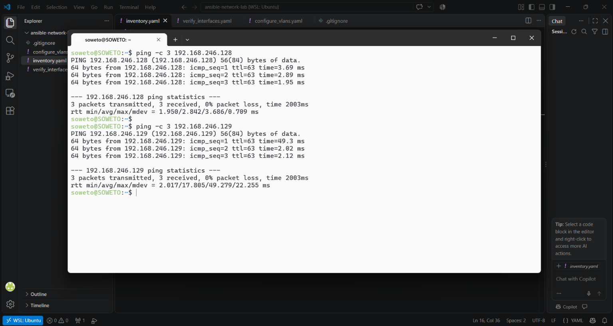
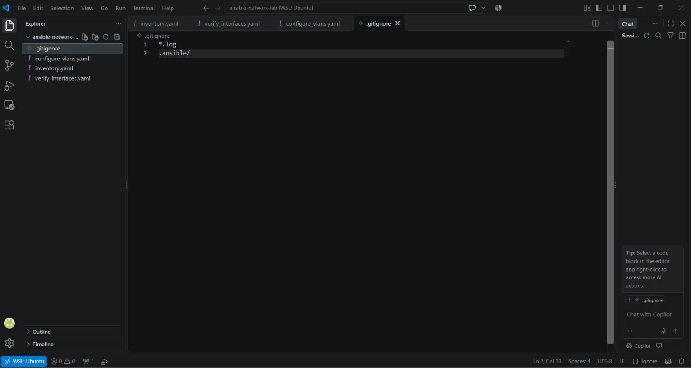
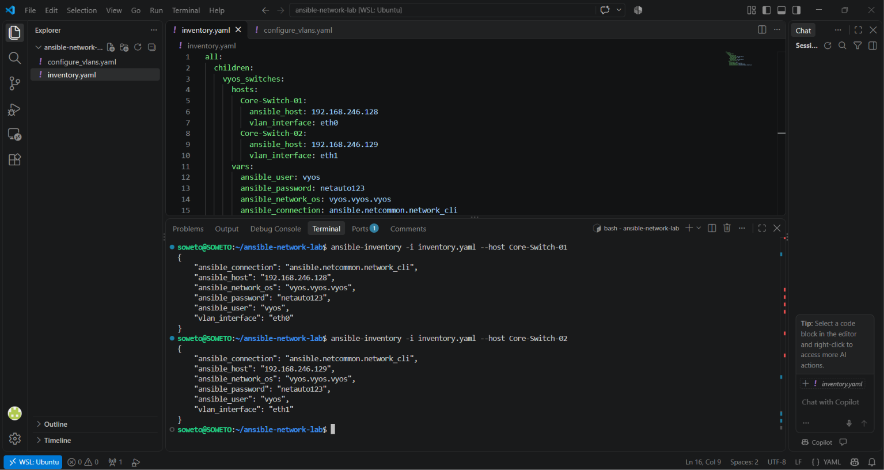
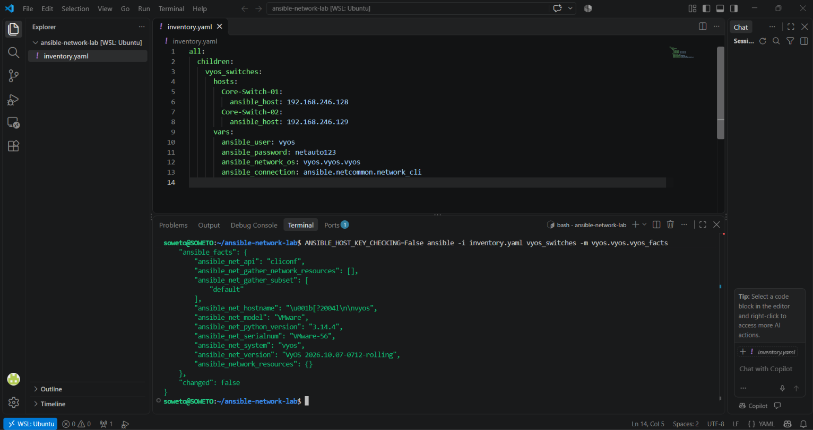
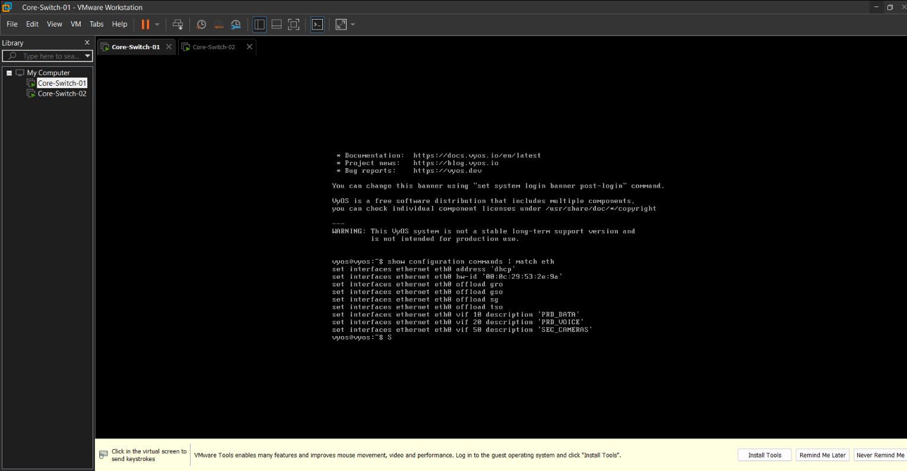
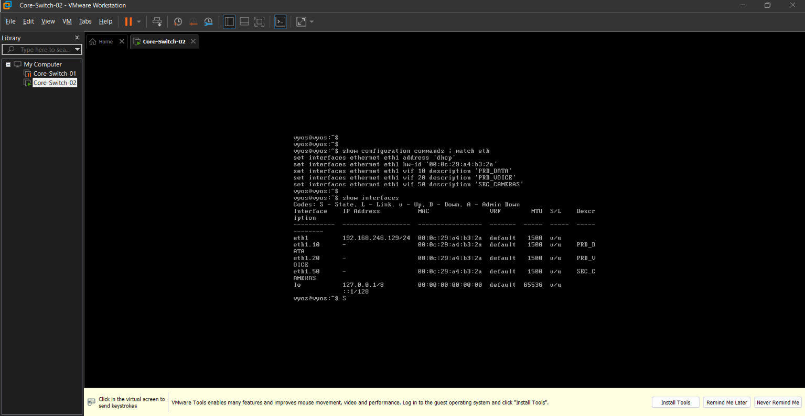
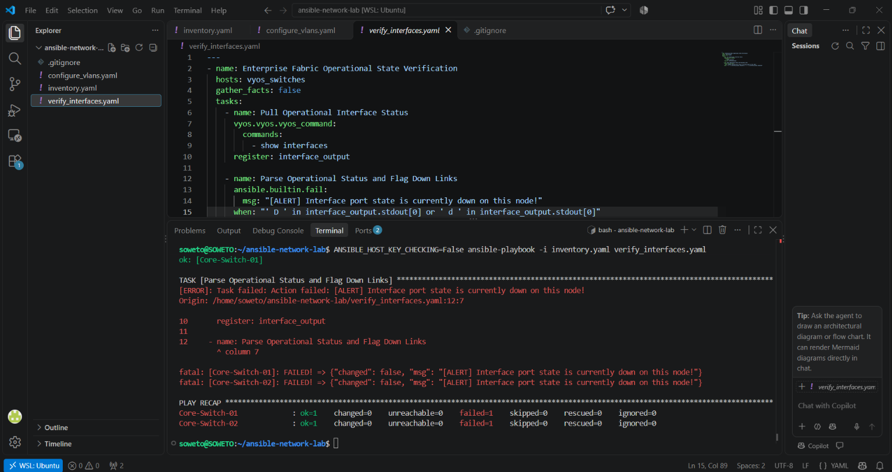

# Enterprise Network Automation Fabric: Multi-Node VLAN Deployment & State Verification

An enterprise-grade network automation project deploying virtual local area networks (VLANs) across multiple infrastructure layers simultaneously using **Ansible Core**. This repository avoids basic simulators by orchestrating standalone **VyOS Virtual Enterprise Appliances** running inside a local hypervisor environment. It features declarative configuration playbooks alongside custom programmatic verification gates designed to intercept operational faults before they hit production pipelines.

---

## 🏗️ Production Architecture & Real-World Use Case

In a high-density production environment, manually logging into individual switches via the Command Line Interface (CLI) introduces human configuration error and creates config drift. This deployment utilizes an **idempotent engine** to enforce structural consistency across network switches simultaneously from a centralized inventory model.

To prevent service-disrupting automation lockouts, this architecture incorporates **Out-of-Band Management (OOBM)** patterns. Management interfaces (`eth0`/`eth1`) run on independent routing lanes strictly for SSH orchestration traffic. This isolates the configuration control loop from the production data plane, ensuring administrative connectivity remains active even during drastic interface structural updates.

---

## 🛠️ Technology Stack & Dependencies

*   **Automation Control Node:** Ubuntu Linux (WSL Engine)
*   **Orchestration Engine:** Ansible Core (v2.20.1) / Python 3.14
*   **Infrastructure Hypervisor:** VMware Workstation
*   **Target Core Operating Systems:** VyOS Rolling Release Appliances
*   **Cryptographic Transport Interface:** Paramiko SSHv2 Client Driver Library

---

## 📂 Repository Project Structure

```text
├── inventory.yaml              # Modern YAML multi-device asset map
├── configure_vlans.yaml        # Declarative VLAN layout configuration playbook
├── verify_interfaces.yaml       # Operational interface state gate validation playbook
└── .gitignore                  # Active Git track filter tracking exclusions
```

---

## 🚀 Execution & Verification Pipeline

### Phase 1: Environment Baseline Verification
The automation node validates Layer 3 reachability to the isolated management infrastructure planes across the host virtualization layer using ICMP echo requests before initializing data sessions.



Project environment variables and tracking configurations are structured directly inside a modern IDE workspace configuration.



---

### Phase 2: Host Variable & Inventory Structural Analysis
Devices are grouped into structured object patterns inside `inventory.yaml`. Host-specific attributes are dynamically mapped to individual endpoints while global behavioral connection settings are evaluated across the parent variables block.



Ansible establishes concurrent SSH sockets to collect device facts and run ad-hoc validation routines across targets using Paramiko engine plugins.



---

### Phase 3: Declarative Configuration Pushing
The orchestration engine evaluates `configure_vlans.yaml`. It uses declarative resource parameters to inject corporate profiles (**VLAN 10: PRD_DATA**, **VLAN 20: PRD_VOICE**, and **VLAN 50: SEC_CAMERAS**) across the fabric. To protect automated execution lines, active user configuration attributes are modified with `no-pager` options to block interactive terminal text string pausing.


The script triggers parallel execution blocks, syncing the target infrastructure models into their intended target state.


---

### Phase 4: Post-Deployment State Verification

#### Core Switch Active Configurations
Operational commands verify that the configuration modifications have successfully updated the running network configuration kernel.

**Core-Switch-01 Running Configuration Proof:**


**Core-Switch-02 Running Configuration Proof:**


#### Programmatic Gate Validation & Expected Failures
The verification pipeline `verify_interfaces.yaml` utilizes the `ansible.builtin.fail` intercept engine to catch interface states. This task purposefully throws an exception flag on both devices during verification:



**Architectural Explanation of the Validation Intercept:**
While the parent management interface links (`eth0`/`eth1`) remain completely **UP** and accessible (allowing the playbook to run and receive ping replies), the newly generated virtual subinterfaces (**`eth0.10`**, **`eth0.20`**, and **`eth0.50`**) are explicitly flagged as **Down (`D`)** by the switch operating system. 

In enterprise network mechanics, virtual subinterfaces cannot transition to a live operational **UP** status until physical endpoint machines are connected to the interface ports to send real electrical signaling traffic across that specific tag. The verification engine successfully identifies these un-cabled links using conditional string matching filters (`when: "' D ' in interface_output.stdout"`), purposefully failing the play to alert network administrators of non-operational data ports before shipping to production.
